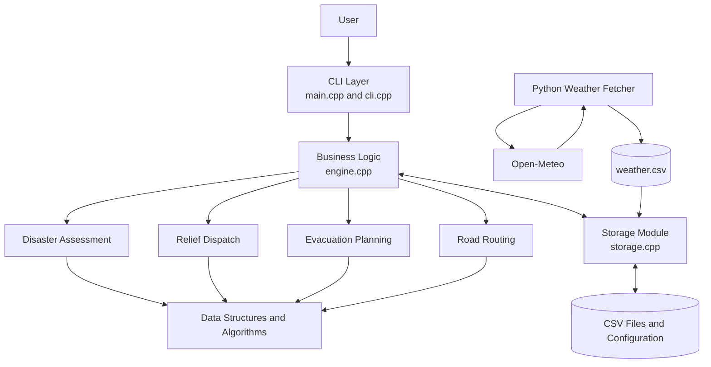

# ResQNet — System Architecture

## 1. Overview

**ResQNet** is a Dynamic Disaster Relief Supply Chain and Evacuation Dispatch System designed to support disaster-response planning, particularly during floods.

The system analyzes information about affected zones, population, flood depth, rainfall, road connectivity, available vehicles, relief supplies, and shelter capacity. It uses this information to prioritize affected areas and support relief-supply dispatch and evacuation planning.

The project is implemented primarily in **C++17**, with a Python script for weather-data integration. It demonstrates modular software design, object-oriented programming (OOP), data structures and algorithms (DSA), and file-based data persistence.

## 2. Architectural Style

ResQNet follows a **modular, layered application architecture**. Each module has a specific responsibility, making the system easier to understand, test, maintain, and extend.

The major architectural components are:

- **Presentation Layer:** Accepts commands and displays results.
- **Business Logic Layer:** Performs disaster assessment, prioritization, dispatch, routing, and evacuation operations.
- **Data Management Layer:** Loads and saves configuration and operational data.
- **Data Structures and Algorithms Layer:** Supports efficient data lookup, priority management, and route planning.
- **External Data Integration:** Retrieves weather information using Python and Open-Meteo.

These are logical layers within the application, not independently deployed microservices.

## 3. High-Level Architecture

The diagram represents the major responsibilities and interactions of the system.

## 4. Major Components

### 4.1 Presentation Layer

**Files:** `src/main.cpp`, `src/cli.cpp`

This layer provides the command-line interface through which users interact with ResQNet.

Responsibilities include:

- Processing command-line arguments.
- Loading the application data before execution.
- Accepting commands through an interactive shell or script.
- Displaying assessment results and operational information.
- Invoking the appropriate business-logic operations.

Examples of supported commands include:

- `assess` — display the priority assessment of affected zones.
- `dispatch` — initiate relief-supply dispatch.
- `evacuate` — initiate evacuation planning.
- `route` — access route-planning functionality.
- `watch` — access the implemented monitoring functionality.

### 4.2 Business Logic Layer

**File:** `src/engine.cpp`

This layer contains the core operational logic of ResQNet. It processes the available data and determines how the system should prioritize and coordinate relief operations.

Its major responsibilities include:

- Assessing disaster-affected zones.
- Calculating impact and priority scores.
- Ordering zones according to priority.
- Selecting suitable vehicles for relief delivery.
- Supporting route selection based on road conditions.
- Planning evacuation toward shelters with available capacity.

The `Engine` interface is declared in `engine.h`, while its implementation resides in `engine.cpp`.

### 4.3 Data Management Layer

**Files:** `src/storage.cpp`, `include/storage.h`

This layer handles file-based data persistence.

It loads and saves information such as:

- System configuration from `config.ini`.
- Zone, depot, and shelter information from `nodes.csv`.
- Road connectivity from `roads.csv`.
- Vehicle information from `vehicles.csv`.
- Reports from `reports.csv`.
- Weather observations or estimates from `weather.csv`.

This separates data handling from the main disaster-management logic.

### 4.4 Data Structures and Algorithms Layer

ResQNet uses data structures and algorithms to manage disaster information and support operational decisions.

| Data structure or algorithm | Purpose |
|---|---|
| Graph | Represents road networks and connectivity between locations. |
| Dijkstra's algorithm | Finds shortest or lowest-cost routes according to the graph's configured edge costs. |
| Max-heap | Manages zones according to their priority scores. |
| Hash map | Supports efficient lookup of nodes using identifiers. |
| Queue | Supports FIFO processing of reports. |
| Linked lists | Represent graph adjacency or edge collections in the C implementation. |

The graph's edge costs can account for road conditions, including flood depth and rainfall-related effects, as implemented in the routing logic.

### 4.5 External Weather Integration

**File:** `tools/fetch_weather.py`

The Python weather-fetching utility integrates weather information from Open-Meteo into the system.

Its workflow is:

1. Read zone identifiers and coordinates from `nodes.csv`.
2. Request relevant weather-model data from Open-Meteo.
3. Extract the rainfall information supported by the weather response.
4. Write the resulting zone-wise data to `weather.csv`.
5. Allow the C++ application to load the weather data through its storage layer.

Weather information supplements the disaster assessment. It is an input to a decision-support model, not a guarantee of actual flood conditions.

## 5. Disaster Assessment and Prioritization

ResQNet uses a configurable impact-scoring approach to prioritize affected zones.

The documented scoring model is:

\[
S=C\times(w_pP+w_dD+w_rR)\times100
\]

Where:

- \(S\) = impact score.
- \(C\) = confidence in the available evidence.
- \(P\) = normalized population factor.
- \(D\) = normalized flood-depth factor.
- \(R\) = normalized rainfall factor.
- \(w_p\), \(w_d\), and \(w_r\) = configurable weights for the three impact factors.

The factors are normalized to the range from 0 to 1, and the weights are configured in `config.ini`.

The confidence model combines independent trust values using:

\[
C=1-\prod_{i=1}^{n}(1-t_i)
\]

Here, \(t_i\) represents the trust assigned to each evidence item.

The confidence model combines evidence according to its configured trust values. Rainfall data can provide weaker supporting evidence. When no evidence is available, the documented behavior is to assign a score of zero rather than dispatch resources on the basis of unsupported evidence.

The scoring model is intended to help rank zones for response planning. Its weights, thresholds, and evidence assumptions require appropriate calibration before real-world use.

## 6. Relief-Supply Dispatch

The dispatch process uses the zone priorities and available operational resources to support relief allocation.

The documented workflow includes:

1. Rank affected zones by their priority scores.
2. Estimate each zone's relief demand from the affected population, units required per person, and planning duration.
3. Identify depots with available stock.
4. Select a vehicle capable of serving the zone and reaching it through the available road network.
5. Consider route cost or estimated travel time when selecting a suitable vehicle.
6. Update the operational allocation according to the implemented dispatch rules.

The vehicle model distinguishes among trucks, boats, and helicopters. Their suitability depends on their configured capabilities and the road or flood conditions.

The current documented dispatch approach allocates one vehicle per zone per run. Actual allocation is constrained by available stock, vehicle capability, and route reachability.

## 7. Evacuation Planning

The evacuation module identifies zones meeting the configured evacuation threshold and supports the allocation of affected people to shelters.

Its main steps are:

1. Identify zones whose priority scores meet the configured evacuation threshold.
2. Find suitable shelters with available capacity.
3. Consider route costs when determining suitable destinations.
4. Allocate evacuees within shelter-capacity constraints.
5. Support splitting an evacuation allocation across shelters when necessary.

This functionality provides a planning aid. It does not independently execute physical evacuations or guarantee that a route is safe under actual field conditions.

## 8. Object-Oriented Design

The C++ implementation uses object-oriented principles to represent the entities involved in disaster response.

### Encapsulation

Data and related operations are organized within classes and modules, helping control access to internal state.

### Abstraction

Common interfaces allow the system to operate on general concepts such as nodes, reports, and vehicles without requiring every operation to depend on a specific concrete type.

### Inheritance

Specialized classes represent different kinds of nodes and vehicles, reusing common behavior where appropriate.

### Polymorphism

The class hierarchy supports working with different concrete entity types through common interfaces.

### Resource Management

The system uses standard C++ facilities, including `std::unique_ptr` and STL containers, to manage dynamically allocated objects and reduce manual memory-management errors.

## 9. Data Flow

A typical operational flow is:

1. **Initialization:** `main.cpp` processes arguments and initializes the application.
2. **Data loading:** `storage.cpp` loads the configuration and operational CSV files.
3. **Weather update:** The Python utility can fetch weather information and update `weather.csv`.
4. **Assessment:** The engine evaluates the available evidence and calculates zone priorities.
5. **Decision support:** The user invokes dispatch, routing, or evacuation operations through the CLI.
6. **Resource planning:** The engine uses the road network, vehicle capabilities, available supplies, and shelter capacities to support its decisions.
7. **Persistence:** Supported changes are saved using the storage module.

## 10. Technology Stack

| Technology | Role |
|---|---|
| C++17 | Core application and business logic |
| Python | External weather-data integration |
| Open-Meteo | Weather-data source |
| CSV files | Operational data storage and exchange |
| INI configuration | Configurable system parameters |
| Graphs and Dijkstra's algorithm | Road-network representation and route planning |
| Max-heap | Priority management |
| Hash maps and queues | Lookup and FIFO processing |
| Git and GitHub | Source-code version control and collaboration |

## 11. Design Benefits

The modular architecture provides several benefits:

- **Maintainability:** Each major responsibility is separated into a dedicated module.
- **Extensibility:** New vehicle types, evidence sources, and operational rules can be added with appropriate changes to the relevant modules.
- **Configurability:** Scoring weights and operational thresholds can be adjusted through configuration.
- **Algorithmic efficiency:** Appropriate data structures support priority handling, lookup, and route planning.
- **Data integration:** Weather information can supplement locally stored disaster data.
- **Testability:** Individual modules and algorithms can be tested separately where their interfaces permit.

## 12. Limitations and Future Improvements

ResQNet is a software prototype intended to demonstrate disaster-response decision support. Before deployment in an actual emergency environment, further work would be needed, including:

- Integration with verified, real-time flood and road-closure information.
- Field validation of impact scores and rainfall thresholds.
- More comprehensive resource allocation across multiple simultaneous demands.
- Reliable synchronization of data between distributed response teams.
- Authentication, authorization, audit logging, and operational security.
- Testing with realistic disaster scenarios and emergency-response experts.
- Validation of route safety, shelter availability, and vehicle operating constraints.

The availability and accuracy of external weather information, local data quality, and the assumptions used by the decision models can affect the results.

## 13. Conclusion

ResQNet combines modular C++ software design, object-oriented modeling, data structures, graph-based route planning, configurable impact assessment, and external weather-data integration into a disaster-relief decision-support system.

Its primary objective is to help organize the prioritization of affected zones, relief-supply dispatch, and evacuation planning through a structured, data-driven approach.
